# Concepts

This page defines the score and the seven statuses. It also gives the design decisions behind them.

- [The mutation score](#the-mutation-score)
- [The seven statuses](#the-seven-statuses)
- [Why Invalid and NoCoverage are excluded](#why-invalid-and-nocoverage-are-excluded)
- [Equivalent mutants](#equivalent-mutants)
- [Status precedence](#status-precedence)
- [The baseline gate is a hard stop](#the-baseline-gate-is-a-hard-stop)
- [Coverage-aware suite selection](#coverage-aware-suite-selection)
- [Truncation is always reported](#truncation-is-always-reported)
- [Determinism](#determinism)
- [Operational note: why workers are subprocesses](#operational-note-why-workers-are-subprocesses)
- [Pipeline](#pipeline)

## The mutation score

```
score = killed / (killed + survived)
```

The tool reports the score as a percentage in `[0, 100]`. When nothing was scored, the score is `0`.

The denominator is the important part. It counts only the mutants that grade your assertions:

- **Killed**: a test looked at the rendered output and disagreed with it. Your suite caught the
  change.
- **Survived**: the mutation changed the chart and every covering test still passed. This is a
  missing assertion.

The tool counts, names and shows all other mutants, but it keeps them out of the fraction. If it
added any of them, the number would look better than it is.

The score has bands for colour and for the HTML/Stryker `thresholds` field: **≥ 80%** is good,
**≥ 50%** is middling, and below that is poor.

## The seven statuses

| status | meaning | in the score? |
|---|---|---|
| `Killed` | At least one assertion failed. The tests noticed. | **yes** |
| `Survived` | Every covering test still passed. A missing assertion. | **yes** |
| `NoCoverage` | No test suite exercises the mutated file, so the mutation never ran. | no |
| `Invalid` | The mutation stopped the chart rendering. | no |
| `Equivalent` | The mutation provably cannot change any rendered manifest. See [below](#equivalent-mutants). | no |
| `Timeout` | Evaluation took longer than the per-mutant timeout. | no |
| `Error` | The tool itself failed on this mutant (chart copy, load, suite setup). | no |

`Status.CountsTowardScore()` returns true only for `Killed` and `Survived`. Every report format
lists the non-scoring counts next to the score. See [reports.md](reports.md).

## Why Invalid and NoCoverage are excluded

**`Invalid` is not a kill.** If a mutation breaks template rendering, every test in the suite
"catches" it, whatever those tests assert. A suite of four `isKind` assertions catches it as
reliably as a suite of forty `equal` assertions. So it says nothing about assertion quality. If the
tool counted it as a kill, a worse mutator would give a higher score, which is the wrong incentive.
The tool excludes it and shows it separately.

Here are two real examples from the fixture chart. First, `yaml-key-delete` removes the whole
`image:` block from `values.yaml`. The Deployment then dereferences nil:

```
values.yaml:3  yaml-key-delete   →  Invalid
  detail: template: sample/templates/deployment.yaml:33:28: executing
          "sample/templates/deployment.yaml" at <.Values.image.repository>:
          nil pointer evaluating interface {}.repository
```

Second, `num-literal` sets an `nindent` width to zero. This merges an included block into its
parent, and the YAML no longer parses:

```
templates/deployment.yaml:19  num-literal  (nindent 8 → 0)  →  Invalid
  detail: yaml: line 22: did not find expected key
```

In both cases nothing rendered, so nothing was graded.

A high invalid rate is a bug in this tool, not in your suite. The repository's
`TestInvalidMutantRateIsLow` fails above 20%. The fixture chart has 20 invalid mutants out of 472,
which is 4.2%.

**`NoCoverage` is not a survivor.** If no suite renders a template, its mutants never run. If the
tool called them "survived", it would blame your tests for changes they never had a chance to catch.
If it called them "killed", that would be false. So they get their own status. The tool also reports
them per file, because each one is a finding.

The fixture chart's weak suite shows this at scale. It declares only two of the chart's seven
templates, so **173 of its 472 mutants (37%) never run at all**:

```
  NO COVERAGE (173)
    templates/configmap.yaml — no suite renders this template (66 mutants never run)
    templates/hpa.yaml — no suite renders this template (39 mutants never run)
    templates/ingress.yaml — no suite renders this template (35 mutants never run)
    templates/poddisruptionbudget.yaml — no suite renders this template (20 mutants never run)
    templates/serviceaccount.yaml — no suite renders this template (13 mutants never run)
```

Those five lines are a different finding from a low score, and a more serious one: five whole
templates have no tests. To fix them, add suites. Do not add assertions to the suites you already
have. The two gaps add up. The weak suite scores 2.3% on the 299 mutants it *did* run, and it never
runs the other 173.

The strong suite has zero no-coverage mutants over the same chart. Its seven suites declare all
seven templates.

The tool excludes `Timeout` and `Error` for the same reason. Neither one observed whether a test
would have noticed the change.

## Equivalent mutants

An **equivalent mutant** changes the chart's source but *cannot* change its rendered meaning. No
assertion can tell the original from the mutant, because the manifest parses to identical data.

This is the same idea as `Invalid`, a mutant that grades nothing, but from the opposite direction.
Every test catches an `Invalid` mutant. No test can catch an equivalent mutant. Neither tells you
anything about your assertions.

**The tool detects them automatically**, and the check is on by default. After the workers finish,
the tool re-renders every remaining `Survived` mutant in-process. There is no chart copy and no
subprocess: `internal/equivalence` uses `helm.sh/helm/v3/pkg/engine` directly. When the evidence
proves it, the tool reclassifies the mutant to `Equivalent`. `--no-equivalence-check` turns the pass
off, for when the extra render time is not worth it.

### The parsed-render comparison

For each survivor, the tool renders the chart with and without the mutation. It does this under
every **context** from the mutant's covering suite files. There is one context per non-skipped test
job in those files. The tool rebuilds each context from that job's merged `Values`, `Set`, release,
chart and capabilities settings. This is the same merge that helm-unittest does internally.

The tool tracks coverage per suite *file* (`Mutant.CoveringSuites`). A file can hold several
`suite:` documents, and only one of them may render the mutated template. Even then, the tool uses
every job in that file as a context. This checks more value sets than necessary, never fewer. That
makes an `Equivalent` verdict harder to earn, not easier.

Under each context, the tool first compares the two renders byte for byte. It parses them only when
the bytes differ. Parsed equality is what matters, because `nindent 4 → 5` changes every byte and no
data. For a structured YAML manifest, that comparison is the recipe below, automated. helm-unittest
computes every assertion over a YAML manifest from the parsed document. So no such assertion can tell
parsed-equal renders apart.

`.txt` templates (`NOTES.txt` and similar) are the one exception. helm-unittest stores their output
verbatim. Three validators (`equal_raw_validator.go`, `match_regex_raw_validator.go`,
`snapshot_raw_validator.go`) assert on that raw string directly. So the tool compares `.txt` renders
as exact text, not parsed.

A render error counts as an outcome. It does not make the context "inconclusive". A common, real
pattern is a suite job that supplies no value for a `required` field and asserts the failure message.
The fixture chart has one.

If the mutant and the original both fail to render with the *same* message
under a context, that agreement is evidence that the mutation is invisible there. A context becomes
inconclusive only when the tool cannot carry out its own render of either side at all. Examples: the
chart cannot be loaded, the mutated file cannot be re-parsed, or the tool cannot build a probe for the
span.

### The execution probe, and why an unexercised span stays `Survived`

Identical renders happen for two very different reasons:

- The mutation cannot change the output.
- The values of the covering tests never reach the mutated line.

The second case is a real missing assertion. If the tool excluded it, the score would look better
than it is, which this project forbids. So the tool judges a mutant `Equivalent` only after an
**execution probe** proves that the span ran.

The probe is a maximal perturbation at the same span, and it does not depend on the mutation:

- A template span becomes `{{ fail "canary" }}` (or the `if`/`with`/`range` equivalent, with the
  trim markers kept). It errors as soon as it evaluates.
- A `values.yaml` span becomes a non-empty sentinel string. That string is truthy even where the
  original was `false`, `0` or `""`.

The span ran if the probe's outcome differs from the original's outcome in some context. This covers
a render error that the probe causes and an output change that the probe causes. It is also correct
when the original already errors: a probe that reproduces that same error proves nothing.

Sometimes a mutant's render is identical everywhere, but its probe never differs from the original.
That mutant stays `Survived`, with the detail `not exercised by any covering test`. Nobody has written
a test that reaches that line yet. So it stays a real finding that you can act on, and the tool does
not drop it.

**The probe must never be wider than the mutation.** Go templates short-circuit `and` and `or`. Take
this line:

```
{{- if and .Values.ingress.enabled (eq .Values.ingress.className "nginx") }}
```

If `ingress.enabled` is false under every covering job, the `eq` never evaluates. But a probe over
the whole `and ...` pipeline errors anyway, because the action itself is reached. That would prove
the wrong thing and promote two killable mutants to `Equivalent`.

So for a mutation behind a short
circuit, the probe replaces only the mutation's own parenthesised sub-pipeline:
`{{ if and .Values.a (fail "canary") }}`. Sometimes nothing isolates the mutation, for example a bare
operand without parentheses. Then there is no probe and the mutant stays `Survived`. No probe is
better than a probe that proves the wrong thing.

When the pass cannot reach a verdict for any of these reasons, the report shows the count next to the
score (`N survivors could not be checked for equivalence`). Each mutant's `detail` says why. "The
check ran" and "the check concluded" are different claims. A report that showed only the first would
look like a fully verified run.

Two things are outside the check's scope on purpose:

- A suite can install a fake Kubernetes provider (`kubernetesProvider:`). Then `lookup` returns
  objects that the tool's own renderer never sees. So the tool skips detection for that suite's
  mutants, and they stay `Survived`.
- The tool ignores a chart's post-renderer. A post-renderer can only collapse two different inputs
  into one output. It can never split two identical ones. So ignoring it can only make the tool report
  *not* equivalent, never the reverse.

### How to recognise one by hand

The automated check above does this for you. You can still use these steps to verify a verdict by
hand, or to check a survivor when the check is off. Render the chart before and after the mutation.
Then compare the **parsed** documents, not the text:

```console
$ helm template t ./chart               > a.yaml     # original
$ helm template t ./mutated-chart       > b.yaml     # mutation applied by hand
$ python3 -c "
import yaml
a=[d for d in yaml.safe_load_all(open('a.yaml')) if d]
b=[d for d in yaml.safe_load_all(open('b.yaml')) if d]
print('parsed-equal:', a==b)"
parsed-equal: True
```

`parsed-equal: True` means the mutant is equivalent. Stop work on it and go to the next survivor.
`False` means the mutant is killable, and the survivor is a real missing assertion.

Render with the values that the mutated code path needs. Take a mutation inside
`{{- if .Values.ingress.enabled }}`. Under default values, it compares equal only because neither side
renders anything. That is a vacuous pass, not equivalence.

### The two patterns that show up in Helm charts

The fixture chart shows both. Its strong suite's equivalence pass finds 26 equivalent mutants. These
are all the survivors that the killed/survived split alone would have left. 21 of them are these two
patterns. The by-hand comparison above confirmed them, both under default values and with
every feature toggle on.

The other 5 are `pipe-drop` removing a `| quote` from a value that is already a
plain string. YAML parses that to the same string either way.

**1. An `indent` / `nindent` width incremented by one.** YAML does not care about the absolute
indentation of a block mapping. It only needs the block to be deeper than its parent. So
`nindent 4 → 5` emits different bytes and identical data. All 14 of the fixture's `num-literal`
survivors are this pattern.

The `→ 0` variant at the same sites is different, and the contrast is worth learning. These are the
measurements across the same 14 sites:

| variant | render comparison | tool status |
|---|---|---|
| `nindent N → N+1` | `parsed-equal: True` (14/14) | `Equivalent`, unkillable |
| `nindent N → 0` | parsed data differs (9/14) | `Killed` |
| `nindent N → 0` | manifest no longer parses (5/14) | `Invalid` |

When the indentation goes to zero, a block merges into its parent. That either changes data that a
test pins, or it breaks the YAML. At all 14 sites, the tool's status matched the independent render
comparison.

**2. A `values.yaml` key deleted whose value is already its type's zero value.** When you remove the
key, the value becomes nil. Go templates treat nil and the zero value the same, both for truthiness
and for `| default`. All 7 of the fixture's `yaml-key-delete` survivors are this pattern. Their
renders are *byte-identical*, not only parsed-equal:

| survivor | zero value |
|---|---|
| `values.yaml:6` `tag: ""` | empty string |
| `values.yaml:14` `name: ""` | empty string |
| `values.yaml:44` `enabled: false` (autoscaling) | false |
| `values.yaml:49` `targetMemoryUtilizationPercentage: 0` | 0 |
| `values.yaml:66` `enabled: false` (ingress) | false |
| `values.yaml:73` `enabled: false` (ingress TLS) | false |
| `values.yaml:83` `debug: false` | false |

This pattern also holds beyond the default values. A suite that overrides the key supplies its own
value, whether or not the key exists in `values.yaml`. So the deletion is invisible under every value
set, not only the default one.

### What this means for a score

The fixture chart's strong suite scores **100.0%**: 426 killed, 0 survived, 26 equivalent. The suite
killed every mutant it could kill. The tool excludes the remaining 26 from the denominator. Otherwise
they would lower the score by an amount that no suite could ever recover.

So the tool has already applied this reasoning to any survivor that remains after the equivalence
check. Do not re-check it by hand. It is the tool's best evidence of a real missing assertion. Use the
by-hand recipe only when the check was off (`--no-equivalence-check`), or when you want to confirm that
the automated verdict is right.

## Status precedence

`internal/runner/classify.go` resolves a mutant's suite outcomes in a fixed order. This order is
load-bearing, and `TestClassify` pins it:

1. **Any failed assertion → `Killed`.** A real disagreement beats everything else, including a
   render error elsewhere in the same run.
2. **Otherwise, any render error → `Invalid`.**
3. **Otherwise, any suite-level setup error → `Error`.** That is our failure, not the chart's.
4. **Otherwise, zero tests actually ran → `NoCoverage`.**
5. **Otherwise → `Survived`.**

`Equivalent` is not one of the outcomes of `Classify`, and it is not part of this order. A separate
post-pass over the run decides it later. That pass can only move a mutant that `Classify` already
placed at `Survived`. It never moves a `Killed`, `Invalid`, `Error` or `NoCoverage` mutant.

This keeps
the two concerns apart. `Classify` answers "what happened when the suites ran". The equivalence pass
asks a separate question: "could any suite have caught this at all".

## The baseline gate is a hard stop

Before the tool generates any mutant, it runs the chart's own suites without mutation. If anything
fails, the run stops:

```console
$ helm mutation-test ./my-chart

Cannot measure mutation score:   weak assertions > renders a Deployment
      failed assert isKind: Template:	sample/templates/deployment.yaml

A score measured against failing tests is meaningless.
Fix the suite first, then re-run.
Error: the chart's tests do not pass before mutation:
  weak assertions > renders a Deployment
      failed assert isKind: Template:	sample/templates/deployment.yaml

$ echo $?
2
```

This is a hard stop and not a warning, on purpose. Over a red suite, the existing failure seems to
"kill" every mutant, and the resulting number means nothing. It is better to refuse than to publish
a false score.

The gate also stops the run, with the same exit code 2, in these cases:

- no suite file matches `-f` at all, or
- the matching suites contain no test jobs.

With nothing to measure, a score would be equally false. The baseline run never fails fast (mutant
runs do, under the default `--kill-attribution=first`). So the error message names every broken test
at once.

## Coverage-aware suite selection

helm-unittest suites declare which templates they render. They use a suite-level `templates:` list or
a per-test `template:`. The tool gets this declaration for free and uses it for two things.

**Speed.** A mutant in `ingress.yaml` runs only the suites that render `ingress.yaml`, not the whole
suite set. These are measurements from the fixture chart's strong run, which has 7 suites and 43
tests. The number of tests that a mutant runs depends on its file:

| mutated file | tests run |
|---|---:|
| `templates/hpa.yaml` | 3 |
| `templates/poddisruptionbudget.yaml` | 3 |
| `templates/serviceaccount.yaml` | 3 |
| `templates/ingress.yaml` | 4 |
| `templates/service.yaml` | 4 |
| `templates/configmap.yaml` | 9 |
| `templates/deployment.yaml` | 17 |
| `templates/_helpers.tpl` | 43 |
| `values.yaml` | 43 |

A `poddisruptionbudget.yaml` mutant costs 3 tests instead of 43. That is a 14× saving, for each of
that file's 20 mutants.

**Honesty.** If no suite renders a template at all, its mutants become `NoCoverage` instead of
`Survived`.

The tool treats two kinds of file as covering everything, to be safe. A change to either kind can
affect any rendered template:

- `values.yaml` / `values.yml`: any template may read any value.
- Any file whose basename starts with `_` (a Helm partial such as `_helpers.tpl`): any template may
  `include` any define in it.

This costs runtime, but it never blames a survivor on the wrong suite.

A suite that declares no `templates:` and no per-test `template:` renders all that the chart
produces. So the tool indexes it as global, and no template can be `NoCoverage`.

The tool normalises declared paths before it matches them. `deployment.yaml` and
`templates/deployment.yaml` are the same file, and backslashes become forward slashes.

`internal/coverage` imports nothing else in the module, on purpose. It works with opaque suite IDs,
and `runner.CoverageRefs` adapts them. Keep it that way. The first, simple version had an import
cycle.

## Truncation is always reported

`--max-mutants` takes a deterministic sample from `--seed`. It reports the number of dropped mutants
in **every** format. A silently truncated run would look like full coverage. This tool exists to
prevent exactly that failure.

```console
$ ./bin/helm-mutation-test testdata/charts/sample -f 'tests/strong_test.yaml' \
    --no-color --max-mutants 20

Mutation testing sample  (7 suites, 43 tests, baseline 40ms)

  Score  100.0%  ██████████████████████████   (19 killed / 0 survived)
  not scored: 1 equivalent
  only 20 of 472 generated mutants were run (--max-mutants); 452 not evaluated
```

This sample happens to score the same 100.0% as the full run, but do not rely on that. It is a
sample of 20 out of 472, under 5% of the population. The warning line is there so that nobody quotes
it as the score, even when the numbers match.

The same rule applies to the survivor list in the markdown format. The list stops at 40 entries and
then says `_N further survivors omitted; see the JSON or HTML report._`

## Determinism

Two runs over the same chart produce identical mutant lists and identical mutant IDs. The tool
orders mutants by file path, then byte offset, then mutator ID, then variant note. It sorts the
mutator selection by ID, in whatever order you gave them on the command line. It also sorts suite
file globs, because glob order depends on the filesystem.

A mutant ID looks like `deployment.yaml:2827:required-drop`: basename, byte offset and mutator. When
one mutator produces several mutants at one site, the ID also has a variant suffix
(`_helpers.tpl:140:num-literal:increment` and `_helpers.tpl:140:num-literal:zero`).

Results do not depend on `--parallel`. Tests verify that `-p 1` and `-p 8` produce identical output.

## Operational note: why workers are subprocesses

When `--parallel` is greater than 1, each worker runs in its own OS process, not in a goroutine.
There is a technical reason for this.

helm-unittest's `TestJob.capabilitiesV3` does:

```go
capabilities := v3util.DefaultCapabilities   // a *Capabilities POINTER
capabilities.KubeVersion = ...               // writes through the shared pointer
```

`chartutil.DefaultCapabilities` is a package-level pointer in Helm. So every test job changes
process-global state. `go test -race` flags it. It is a real correctness bug, not only untidy code.
A suite that declares a custom `capabilities.majorVersion` leaks that version into suites that render
at the same time. helm-unittest v1.1.2 has the same code, so an upgrade does not fix it.

So each worker gets its own process, where that global is private. In practice:

- **Workers are long-lived and stream jobs.** The tool pays the process startup cost once per worker,
  not once per mutant.
- **The tool can enforce the per-mutant timeout.** It can kill a hung worker process. It cannot kill
  an abandoned goroutine.
- **`--parallel 1` runs in-process**, because one worker has nothing to race with. The same happens
  when there are fewer mutants than workers: the tool limits the worker count to the number of jobs.
- **Each worker gets its own temporary chart copy** and uses it for all the mutants it handles. The
  parent writes the mutation into the worker's copy and restores the copy after. `--keep-workdir`
  keeps those copies so you can inspect them.

Two related invariants:

- The tool never calls helm-unittest's `cache.StoreToFileIfNeeded()`. A mutant run must not rewrite
  your chart's committed `__snapshot__` files.
- Suite keys are chart-relative. Each worker re-parses suites from its own temp copy. An absolute
  path would never match the baseline's key, and every mutant would silently report `NoCoverage`.

## Pipeline

```mermaid
flowchart LR
    DIS["discover<br/><small>templates + values.yaml</small>"] --> BASE["baseline<br/><small>suites must pass</small>"]
    BASE --> COV["coverage index<br/><small>file → suites</small>"]
    COV --> GEN["generate mutants<br/><small>10 mutators, seeded</small>"]
    GEN --> EVAL["evaluate<br/><small>worker subprocesses</small>"]
    EVAL --> EQ{{"equivalence<br/><small>survivors only</small>"}}
    EQ --> REP["report<br/><small>six formats</small>"]

    click DIS href "../getting-started/#what-gets-mutated" "Which chart files are mutated"
    click BASE href "#the-baseline-gate-is-a-hard-stop" "A red baseline stops the run with exit code 2"
    click COV href "#coverage-aware-suite-selection" "Each mutant runs only the suites that render its file"
    click GEN href "../mutators/" "The ten mutators"
    click EVAL href "#operational-note-why-workers-are-subprocesses" "Why parallel workers are subprocesses"
    click EQ href "#equivalent-mutants" "Survivors that cannot change any rendered manifest"
    click REP href "../reports/" "All six report formats"
```



On the docs site, hover over a box to see its role. Click it to go to the section that explains it.

**The tool finds mutations with a parser but applies them as byte edits.** It parses templates with
Go's `text/template/parse` (with `SkipFuncCheck`, so it needs no sprig or Helm funcmap). It parses
`values.yaml` with `yaml.v3` node positions. The edit then replaces an exact byte range in the
original file. So the formatting stays the same, including Helm's whitespace-sensitive `{{-` trim
markers.

**Kill attribution comes from calling `TestSuite.RunV3` directly.** The tool does not use
helm-unittest's top-level runner, which only prints and returns a bool. The lower-level call returns
the full result tree. That tree lets the tool name the exact assertion that caught each mutation. It
also lets the tool tell a failed assertion (a real kill) from a render error. Every test "catches" a
render error, so it grades nothing.

The repository's [`CLAUDE.md`](https://github.com/mmpyro/helm-mutation-test/blob/main/CLAUDE.md#architecture) lists the responsibilities of each package.
